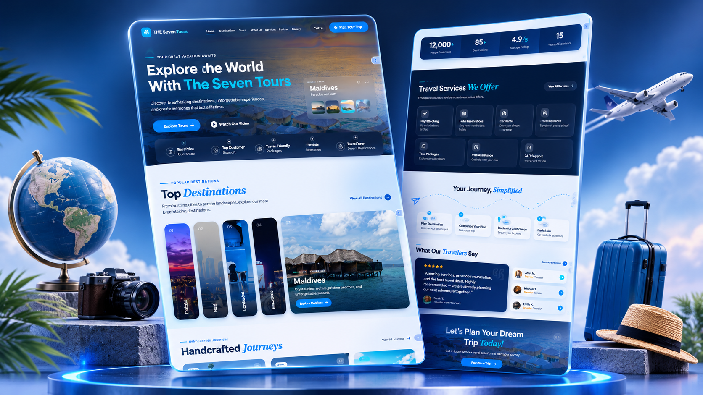

# Seven-Tours-Travel-Landing-page

## ⚡ Built With

  
  

---

## 📖 About The Project

**The Seven Tours** is a premium travel agency landing page designed to inspire wanderlust and convert visitors into travelers. The website combines a clean, modern UI with a deep-blue color palette, elegant typography (a mix of bold sans-serif and italic serif accents), and cinematic scroll-based animations powered by **GSAP**.

The project showcases popular destinations, handcrafted tour packages, travel services, a simple booking journey, customer testimonials, and an immersive photo gallery.

---

## ✨ Features

- 🎬 **Smooth GSAP Animations** – ScrollTrigger reveals, parallax effects, and animated transitions
- 🌍 **Hero Section** – Eye-catching intro with a featured destination slider (Maldives, etc.)
- 🏙️ **Top Destinations** – Interactive expanding cards (New York, Dubai, Abu Dhabi, Las Vegas, Maldives)
- 🧳 **Featured Tours** – Horizontal scrolling handcrafted journeys with badges (Best Seller, Luxury, Romantic)
- 📊 **Animated Stats Counter** – Happy travelers, destinations, ratings, and years of experience
- 🛎️ **Travel Services** – Flights, hotels, car rentals, packages, visa assistance, and 24/7 support
- 🗺️ **How It Works** – 4-step journey with an animated dashed flight path
- 💬 **Testimonials** – Interactive review slider with customer ratings
- 📩 **Call To Action** – Newsletter / trip planning email form
- 🖼️ **Gallery** – Beautiful photo showcase of destinations
- 📱 **Fully Responsive** – Optimized for mobile, tablet, and desktop
- 💱 **Currency Selector** – USD currency switcher in the navbar
- ⚡ **Fast Performance** – Powered by Vite

---

## 🛠️ Tech Stack

| Technology | Purpose |
|------------|---------|
| [React](https://react.dev/) | UI library |
| [Tailwind CSS](https://tailwindcss.com/) | Utility-first styling |
| [GSAP](https://gsap.com/) | Animations & ScrollTrigger |
| [Vite](https://vitejs.dev/) | Build tool & dev server |
| [Lucide React](https://lucide.dev/) | Icons |

---